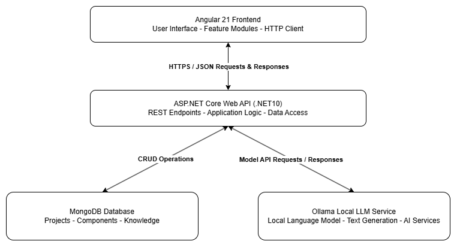
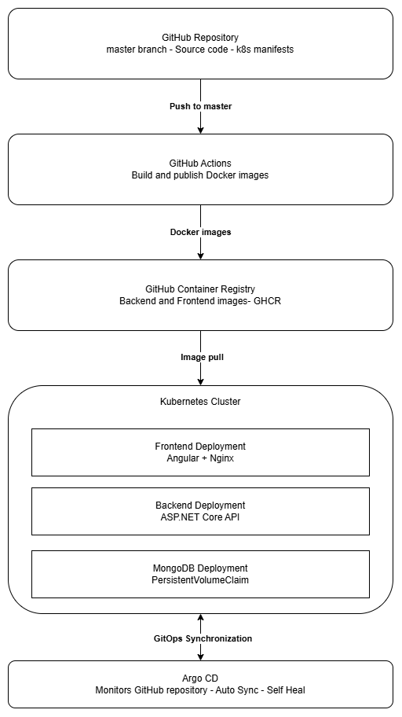

# DevWorkspace – System Architecture

## 1. Overview

DevWorkspace is a web-based developer knowledge management application designed to help developers organize and manage information, reusable development resources, and project-related documentation in a centralized environment.

The application follows a client-server architecture. Its main components are an Angular-based frontend, an ASP.NET Core backend API, and a MongoDB database.

The system can be deployed using Docker Compose or Kubernetes. For Kubernetes deployments, Argo CD provides GitOps-based application delivery and synchronization.

## 2. Technology Stack

| Component | Technology |
|---|---|
| Frontend | Angular 21, TypeScript |
| UI Framework | Bootstrap |
| Backend | ASP.NET Core 10 Web API |
| Database | MongoDB 8 |
| Containerization | Docker |
| Local orchestration | Docker Compose |
| Container registry | GitHub Container Registry (GHCR) |
| CI/CD | GitHub Actions |
| Container orchestration | Kubernetes |
| GitOps | Argo CD |
| Optional AI integration | Ollama, Llama 3.2 3B |

## 3. High-Level Architecture

The application consists of three primary runtime components:

- **Frontend:** Provides the user interface and communicates with the backend through HTTP requests.
- **Backend API:** Handles application logic, processes requests, and manages database operations.
- **Database:** Stores application data, including documents, prompts, tasks, and other development resources.

The frontend does not communicate directly with MongoDB. All database operations are handled by the backend API.

### 3.1 Application Architecture

The following diagram illustrates the main runtime components of DevWorkspace and their communication. It presents the Angular frontend, ASP.NET Core backend API, MongoDB database, and optional Ollama-based AI integration.



### 3.2 CI/CD and GitOps Deployment Architecture

The following diagram illustrates the application's build, image publishing, and deployment workflow. GitHub Actions builds and publishes the frontend and backend Docker images to GitHub Container Registry. Kubernetes retrieves the images, while Argo CD monitors the Git repository and synchronizes the Kubernetes manifests with the cluster.



## 4. Frontend Architecture

The frontend is implemented using Angular 21 and TypeScript.

It provides the user interface for the application's main modules:

- Dashboard
- Documents
- Prompt Library
- Agent Generator
- Architecture Library
- Documentation
- Task Manager
- Workspace

The frontend communicates with the backend through REST API endpoints. API requests use relative `/api/` URLs, allowing the application to work in different deployment environments without hardcoding the backend host address in the Angular services.

In the Docker-based deployment, Nginx serves the compiled Angular application and forwards API requests to the backend service.

## 5. Backend Architecture

The backend is implemented as an ASP.NET Core 10 Web API application.

Its main responsibilities include:

- Handling HTTP requests from the frontend.
- Providing REST API endpoints through controllers.
- Implementing application business logic through services.
- Managing database communication.
- Handling configuration and environment-specific settings.
- Integrating with the optional local AI service.

The backend uses dependency injection to manage application services and database-related components.

## 6. Database Architecture

MongoDB 8 is used as the application's NoSQL database.

The database stores the information required by the different application modules. The backend accesses MongoDB through the MongoDB data access layer.

The database is deployed as a separate service and uses persistent storage to preserve data when containers or application Pods are restarted.

The deployment configurations define the database connection settings through environment variables.

## 7. Optional AI Integration

DevWorkspace supports optional local AI functionality through Ollama.

Ollama runs as a separate process on the host machine and provides an HTTP API that the backend can use to communicate with a locally installed language model.

The currently configured model is `llama3.2:3b`.

The AI integration is optional and is not required for the core application functionality. When Ollama is unavailable, the standard application modules remain usable, while AI-dependent features require the local AI service to be running.

## 8. Containerization and Deployment

The application provides two deployment options.

### 8.1 Docker Compose

Docker Compose is intended for local development and straightforward deployment.

It starts the following services:

- MongoDB database
- ASP.NET Core backend
- Angular frontend served by Nginx

The frontend is exposed on port `4200`, the backend on port `8080`, and MongoDB on port `27017`.

The MongoDB service uses a named Docker volume to preserve database contents.

### 8.2 Kubernetes

The Kubernetes deployment runs the application components as separate Kubernetes resources.

The deployment includes:

- A dedicated application namespace.
- MongoDB Deployment, Service, and PersistentVolumeClaim.
- Backend Deployment and Service.
- Frontend Deployment and Service.

The frontend and backend communicate through Kubernetes Services. The database is accessible to the backend through the MongoDB Service.

Persistent storage is configured for MongoDB to retain application data across Pod restarts.

## 9. CI/CD and GitOps Workflow

The project uses GitHub Actions to build and publish Docker images to GitHub Container Registry.

The workflow is triggered by pushes to the `master` branch and can also be started manually.

The pipeline builds separate images for the frontend and backend and publishes them to GHCR.

Argo CD monitors the GitHub repository and the `k8s/` directory. When changes are pushed to the configured branch, Argo CD detects the updated Kubernetes manifests and synchronizes the desired application state with the Kubernetes cluster.

Automated synchronization and self-healing are enabled.

## 10. Repository Structure

The repository is organized into the following main directories:

```text
DeveloperWorkspace/
├── .github/
│   └── workflows/
├── DeveloperWorkspace.Api/
├── developer-workspace-ui/
├── docs/
│   ├── architecture/
│   │   ├── ARCHITECTURE.md
│   │   ├── APPLICATION-ARCHITECTURE.png
│   │   └── CICD-AND-GITOPS-ARCHITECTURE.png
│   └── installation/
│       ├── ARGO-CD-DEPLOYMENT.md
│       └── DOCKER-COMPOSE-DEPLOYMENT.md
├── k8s/
├── docker-compose.yml
├── README.md
└── DeveloperWorkspace.slnx
```

The backend and frontend source code are maintained in separate directories. Kubernetes manifests, deployment documentation, and CI/CD configuration are stored independently.

## 11. Summary

The DevWorkspace architecture separates the user interface, application logic, and data storage into independent components.

This separation improves maintainability and allows the application to be deployed in different environments. Docker Compose provides a simple local deployment option, while Kubernetes and Argo CD support container orchestration and automated GitOps-based deployment.

The optional Ollama integration provides local AI capabilities without making an external cloud-based AI service a mandatory dependency.